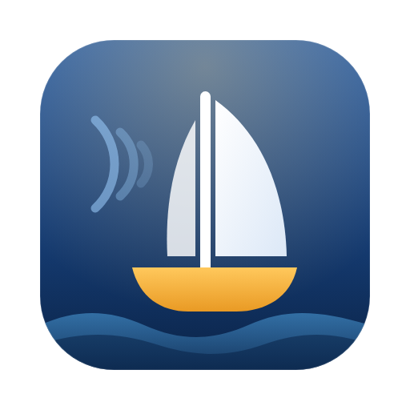

<p align="center"></p>

<h1 align="center">Sirenward</h1>

<p align="center"><em>Wie Odysseus am Mast: Du legst dich im Voraus fest und segelst an den Lockrufen vorbei.</em></p>

<p align="center"><a href="README.md">English</a> · <a href="PRIVACY.de.md">Datenschutz</a> · <a href="AUDIT.md">Sicherheitsaudit (EN)</a> · <a href="SECURITY.md">Sicherheitslücke melden (EN)</a></p>

Open-Source-Browsererweiterung gegen digitale Ablenkung. Sie kombiniert **Website-Sperre**, die Ansichtsfunktionen von **Unhook** und die Filter von **BlockTube** und hat einen **Sperrmodus**, den du dir selbst nicht einfach wieder abschalten kannst.

**Datenschutz zuerst:** keine Server, keine Konten, kein Tracking, kein Verlauf. Die Erweiterung kann technisch keine Daten versenden.

Läuft in Chrome, Brave, Edge, Vivaldi, Opera (ab Version 120) und Firefox (ab 128). Die Oberfläche gibt es auf **Deutsch und Englisch**, sie folgt der Sprache deines Browsers.

## Funktionen

**Websites sperren**
- Domains inklusive aller Subdomains sperren
- Die Sperre sitzt im Browser selbst. Deshalb greift sie **auch mit VPN, anderem DNS oder DNS-over-HTTPS**, anders als eine Router-Sperre.
- Über das Popup sperrst du die aktuelle Seite mit einem Klick.

**YouTube-Ansicht (wie Unhook)**
- Startseiten-Feed ausblenden oder direkt zu den Abos weiterleiten
- Empfehlungen, Shorts, Kommentare, Endcards und Autoplay abschalten
- Shorts-Links öffnen als normales Video

**YouTube-Filter (wie BlockTube)**
- Kanäle (per @Handle, Name oder Link) und Stichwörter im Titel sperren
- **Strikter Modus:** Nur Kanäle, die du erlaubst, sind sichtbar und abspielbar.
- Gesperrte Videos sind schon im ersten Bild unsichtbar. Wer sie direkt aufruft, sieht eine Sperrseite, und das Video bleibt angehalten.

**Zeitfreigabe**
- Gesperrte Seiten kurz freigeben, z. B. **15 min**, danach sperren sie sich von selbst wieder.
- **Tageslimit pro Seite** (Standard: 3 Freigaben).
- **Bewusste Hürde:** erst eine Wartezeit, dann einen Satz abtippen. Es zählen nur die Buchstaben, Groß-/Kleinschreibung ist egal, Einfügen ist gesperrt.
- Nach Ablauf laden offene Tabs der Seite nichts mehr nach. Mit eigener Sperrseite werden sie automatisch neu geladen.

**Sperrmodus**
- Gilt für 1 Stunde bis 30 Tage. In dieser Zeit lassen sich Regeln nur **verschärfen**, nicht lockern.
- Versuche, die Sperre zu umgehen, werden automatisch zurückgedreht: Speicher bearbeiten oder löschen, Import, Systemuhr vor- oder zurückstellen.

**Optionale Zusatzfunktionen** (standardmäßig aus)
- **Zeitplan:** sperren nur zu festen Zeiten, auch über Mitternacht.
- **Fokus-Sitzung:** Ein Klick sperrt alles auf der Liste und pausiert Freigaben.
- **Eigene Sperrseite** mit Restzeit und Freigabe-Knopf. Dafür wird der Zugriff nur auf die gesperrten Domains angefragt und beim Entfernen einer Domain wieder entzogen.
- **Partner-Code:** Eine andere Person legt einen Code fest, ohne den sich nichts lockern lässt.
- **YouTube-Tageslimit:** begrenzt die echte Wiedergabezeit pro Tag.
- **Lokale Statistik:** nur Zähler pro Tag, keine Adressen, maximal 30 Tage.
- **Mehr YouTube-Optionen:** Suchvorschläge und „Erkunden“/Trends ausblenden, Vorschaubilder in Graustufen.

## Installation

Jedes Release enthält zwei Pakete mit identischem Code, die sich nur im Manifest unterscheiden:
- `sirenward-<version>-chromium.zip` für Chrome, Brave, Edge, Vivaldi und Opera
- `sirenward-<version>-firefox.zip` für Firefox

Entpacke das passende ZIP in einen Ordner deiner Wahl.

### Chrome, Edge, Brave
1. `chrome://extensions` öffnen (Edge: `edge://extensions`).
2. **Entwicklermodus** einschalten.
3. **Entpackte Erweiterung laden** wählen und den entpackten Chromium-Ordner auswählen.
   Beim Aktualisieren: alte Version entfernen oder in `chrome://extensions` auf „Neu laden“ klicken.
4. Empfohlen: In den Details der Erweiterung **„Im Inkognito-Modus zulassen“** einschalten.

### Firefox
- Über [addons.mozilla.org](https://addons.mozilla.org/), sobald Sirenward dort gelistet ist.
- Zum Testen: `about:debugging#/runtime/this-firefox` → **Temporäres Add-on laden** → `manifest.json` auswählen. Das bleibt bis zum Neustart aktiv.
- Danach unter *Add-ons → Sirenward → Berechtigungen* den Zugriff auf `www.youtube.com` erlauben und *„In privaten Fenstern ausführen“* aktivieren.

### Echtheit prüfen
```bash
node tools/build.js          # aus dem Quellcode neu bauen → bitgleiche ZIPs in dist/
sha256sum -c dist/SHA256SUMS
```

## Ehrliche Grenzen
Eine Browsererweiterung lässt sich immer deaktivieren oder deinstallieren, und andere Browser sind nicht geschützt. Der Sperrmodus macht spontanes Abschalten deutlich unbequemer, verhindert es aber nicht vollständig. Für mehr Härte kombinierst du Sirenward mit der Router-Sperre. Gegen das Deinstallieren hilft eine Browser-Richtlinie, die jemand anderes für dich einrichtet. YouTube ändert gelegentlich seinen Seitenaufbau; die Selektoren stehen gesammelt in `content.js` und `content.css`.

## Architektur

```
 Popup / Einstellungen ──Befehl──▶ background.js ──schreibt──▶ storage.local
   (client.js)          ◀─Antwort─  (einziger Schreiber,        │
                                     serielle Warteschlange)    ├─▶ declarativeNetRequest (Website-Sperre)
                                          │                    └─▶ Sperr-Snapshot + Uhr-Überwachung
                                          │ Leseansicht (nur yt + filter)
                                          ▼
                                     content.js  (YouTube, isolierte Welt, KEIN Speicherzugriff)
                     alle Entscheidungen: core.js (reine Funktionen, ohne Ein-/Ausgabe)
```

| Datei | Aufgabe |
|---|---|
| `core.js` | **Functional Core:** Normalisierung, Bereinigung, Filter, Befehle (`applyOp`, `applyStateOp`), Sperr-Richtlinie (`resolveState`), Zeitplan, Freigaben, Sperrregeln (`buildRules`). Ohne Browser-APIs, komplett in Node testbar |
| `background.js` | **Imperative Shell** (ES-Modul): einziger Schreiber, Absenderprüfung, Website-Sperre, Manipulationsschutz |
| `client.js`, `i18n.js` | Befehls-API und Übersetzungen für die Seiten, inkl. Dialog für den Partner-Code |
| `unlock-ui.js` | Freigabe-Baustein (Wartezeit + Abtippen) für Popup und Sperrseite |
| `blocked.*` | optionale eigene Sperrseite |
| `content.js` / `.css` | YouTube: inkrementelles Filtern vor dem ersten Bild, Video-Tor, Sperrseite |
| `popup.*`, `options.*`, `ui.css` | Oberfläche im Stil der macOS-Systemeinstellungen, hell und dunkel (einmal aufgebaut, danach gezielt aktualisiert) |
| `tools/messages.js` | alle Texte auf Englisch und Deutsch; daraus wird `_locales/` erzeugt |
| `tools/` | reproduzierbarer Build (Chromium + Firefox); `files.js` legt die Laufzeitdateien fest, `manifest.firefox.json` die Firefox-Ergänzungen |
| `tests/` | alle Tests, Benchmark, Test-Infrastruktur |

## Tests
```bash
npm test                 # Unit-, Hintergrund- und Übersetzungstests + statischer Sicherheits- & Architektur-Scan
npm run test:mutation    # absichtlich eingebaute Fehler – alle müssen erkannt werden
npm run test:e2e         # echtes Chromium: Funktionen, Sprachen, Sperrseite, CSP-Probe, Netzwerk-Mitschnitt
node tools/i18n.js       # _locales/ neu erzeugen, nachdem tools/messages.js geändert wurde
npm run bench            # Leistungsmessung
npm run verify           # alles, inkl. Build und Test des gebauten Pakets
```
Benötigt werden Node ≥ 20, die Pakete `typescript` und `playwright` (mit Chromium), `openssl`, `zip` sowie für den Browsertest die Ports 80 und 443.

## Lizenz
MIT, siehe [LICENSE](LICENSE).
